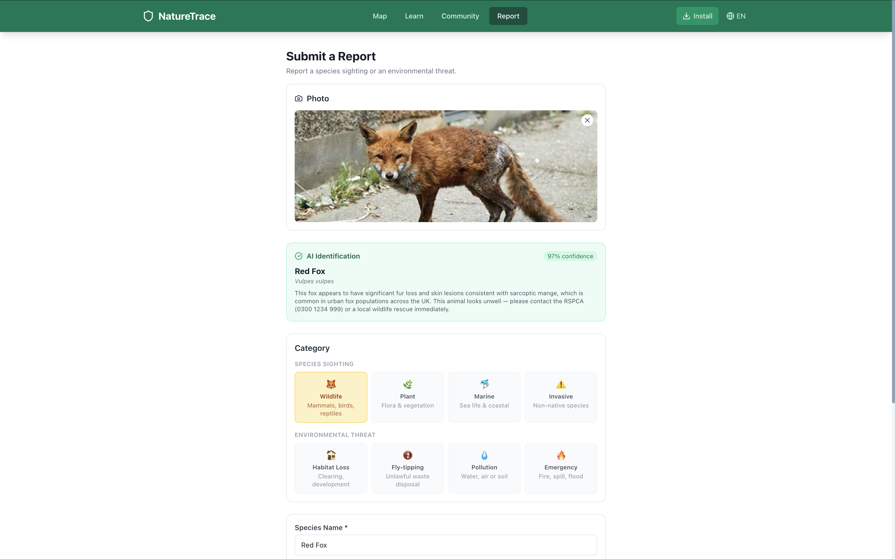

# 🌿 NatureTrace

**AI-powered biodiversity reporting for the UK.** Spot a species or an environmental threat, snap a photo, and NatureTrace identifies it, maps it in real time, and routes it to the organisation that can act on it.

🏆 **1st place — Tech4Positive Futures: Youth Voices, Google London (2026)**

**[Live app → naturetrace.netlify.app](https://naturetrace.netlify.app)** · [Mobile app](https://github.com/sisaymehari/NatureTrace-mobile)



---

## The problem

Most wildlife sightings and environmental incidents in the UK go unreported. People don't know *what* they've seen, or *who* to tell. Invasive species spread, fly-tipping sits for weeks, and the organisations that could respond never hear about it.

NatureTrace makes reporting take under a minute: the AI does the identification, and the app works out who should know.

## Features

- **AI species identification:** upload a photo and Claude's vision model returns the species, scientific name, confidence score, conservation note, similar species, and whether it's invasive in the UK.
- **8 report categories:** wildlife, plants, marine life, invasive species, habitat destruction, illegal dumping, pollution, and environmental emergencies.
- **Live map:** reports appear instantly for every user via Supabase Realtime, with clustered markers (Leaflet) and category filters.
- **Smart routing:** each category maps to the right responder (RSPCA, Environment Agency, Natural England, GB Non-Native Species Secretariat, and others), with an email alert via Resend for high-priority reports.
- **Biodiversity assistant:** an AI chat tuned to UK ecosystems that helps users identify what they've found and nudges them to log it.
- **Works offline:** reports made without signal are queued locally and synced when the connection returns (service worker + offline queue). Installable as a PWA.
- **Tree cover score:** neighbourhood tree metrics pulled live from OpenStreetMap (Overpass API), with server-side caching and endpoint fallbacks.
- **Gamification:** eco-points, badges, and daily streaks to keep citizen scientists coming back.
- **Data export:** all reports downloadable as CSV for researchers and councils.
- **Bilingual:** English and French.

## Tech stack

| Layer | Tools |
|---|---|
| Frontend | Next.js 16 (App Router), React 19, TypeScript, Tailwind CSS 4 |
| Maps | Leaflet, react-leaflet, leaflet.markercluster, OpenStreetMap / Overpass API |
| Backend | Next.js API routes, Supabase (Postgres + Auth + Storage + Realtime) |
| Geospatial | PostGIS (`geography(Point)` with GiST index) |
| AI | Anthropic Claude (vision for identification, chat assistant) |
| Email | Resend |
| Hosting | Netlify |

## How it works

```
 Photo + description
        │
        ▼
 /api/identify ──► Claude vision ──► species, confidence, invasive flag
        │
        ▼
 /api/reports ──► Supabase (PostGIS) ──► Realtime ──► live map for all users
        │
        ▼
 /api/alerts ──► category → responder lookup ──► email via Resend
```

### Technical decisions

- **PostGIS over plain lat/lng columns:** storing locations as `geography` points with a spatial index keeps "reports near me" queries fast as the dataset grows.
- **Row Level Security everywhere:** anyone can read reports, but users can only create and edit their own; the alerts table is only accessible to the server.
- **Structured AI output:** the identification prompt asks for strict JSON, and the response is cleaned and parsed server-side so the UI never receives free text it can't render.
- **Resilient external calls:** the Overpass API is slow and often rate-limited, so tree data is cached for 5 minutes and falls back across three mirror endpoints.

## Running locally

```bash
git clone https://github.com/sisaymehari/NatureTrace.git
cd NatureTrace
npm install
```

Create a `.env.local` file:

```bash
NEXT_PUBLIC_SUPABASE_URL=
NEXT_PUBLIC_SUPABASE_ANON_KEY=
SUPABASE_SERVICE_ROLE_KEY=
ANTHROPIC_API_KEY=
RESEND_API_KEY=
ALERT_RECIPIENT_EMAIL=
NEXT_PUBLIC_APP_URL=http://localhost:3000
```

Set up the database by running `supabase-schema.sql` in the Supabase SQL editor (it enables PostGIS, creates the tables, RLS policies, storage bucket, and Realtime publication). Then:

```bash
npm run dev
```

Open [http://localhost:3000](http://localhost:3000).

## Project status

NatureTrace is a working prototype. Alerts are currently sent to a single review inbox rather than directly to organisations, so every report can be checked before real partnerships are set up. The category-to-responder mapping is in `lib/alert-contacts.ts`.

## Roadmap

- [ ] Verified partnerships with local councils and conservation groups for direct alerts
- [ ] Moderation and verification workflow for reports
- [ ] Automated tests for API routes
- [ ] More languages

## Related

- **[NatureTrace Mobile](https://github.com/sisaymehari/NatureTrace-mobile):** React Native / Expo companion app for iOS and Android

## Author

Built by **Sisay Mehari** · [Portfolio](https://sisaymehari.github.io/portfolio) · [LinkedIn](https://linkedin.com/in/sisay-mehari) · meharisisay6@gmail.com
